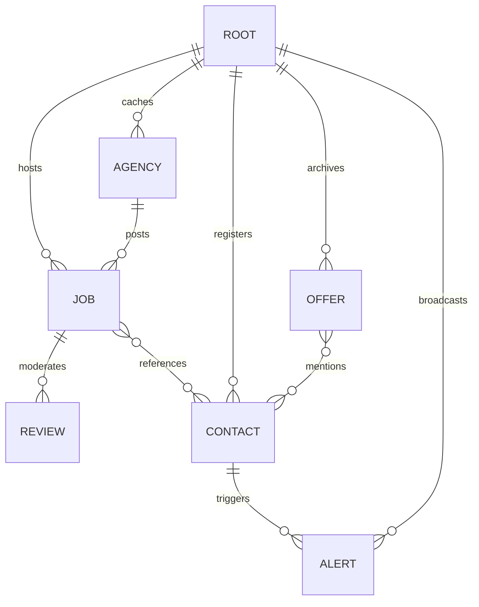

# SafeRata: Database Design & Graph Schema Specification

**Document Version:** 1.0.0  
**Date:** 2026-10-17 14:34 UTC+5:30  
**Storage Architecture:** Jaseci Graph Architecture (Embedded PostgreSQL Storage Engine)  
**Target Runtime:** `jac 0.34.24`  
**Repository:** https://github.com/chirana07/saferata (`main`, commit `1116d58`)

---

## 1. Graph Entity Relationship Diagram



---

## 2. Graph Node & Relationship Definitions

### A. Node `Job` (`jobboard.jac`)
Represents an overseas employment opportunity posted by a verified agency.
```jac
node Job {
    has title: str,                    # Job role (e.g., Welder, Light vehicle driver)
        country: str,                  # Destination country (e.g., Qatar, Malaysia)
        salary: str,                   # Raw salary string (e.g., QAR 2200)
        description: str,              # Full advert or contract terms
        licence_no: str,               # SLBFE labour licence number
        agency_name: str = "",         # Registered corporate name
        contact_phone: str = "",       # Agency contact phone
        posted_at: str = "",           # ISO timestamp
        band: str = "",                # LOOKS SAFE | BE CAREFUL | DANGER
        score: int = 0,                # Total risk score (0-100)
        base_score: int = 0,           # Score before worker reviews
        summary: str = "",             # Concise forensic summary
        top_flags: list[str] = [],     # Primary detected red flags
        warnings: list[str] = [],      # Impersonation and scam alerts
        occupation: str = "",          # Occupation group (Hospitality, Construction)
        experience_years: int = 0,     # Minimum experience
        contract_type: str = "",       # Fixed term | Renewable | Seasonal
        contract_months: int = 0,      # Duration in months
        accommodation: str = "",       # Free accommodation disclosure
        deductions: str = "",          # Itemized deductions
        monthly_deductions: float = 0.0,
        worker_fee_lkr: float = 0.0,   # Agency fee charged to candidate
        appeals: list[str] = [],       # Accepted agency appeals
        corrections: list[str] = [],   # Moderator correction requests
        findings_raw: list[str] = [];  # Serialized forensic evidence
}
```

### B. Node `Review` (`jobboard.jac`)
Stores moderated worker feedback and scam allegations.
```jac
node Review {
    has author: str,                   # Submitting worker (or "Anonymous")
        kind: str,                     # fraud | positive | other
        text: str,                     # Worker experience statement
        evidence: str,                 # Bank slip / receipt / chat proof
        credibility: int = 0,          # Assessed by Review Verifier (0-100)
        status: str = "",              # credible | unverified
        reason: str = "",              # Verifier rationale
        impersonation: bool = False,   # True if third-party impersonation
        agency_response: str = "",     # Public rebuttal by licensed agency
        created_at: str = "";          # Submission timestamp
}
```

### C. Node `Agency` (`graph.jac`)
Stores verified official records fetched from `applications.slbfe.lk`.
```jac
node Agency {
    has name: str,                     # Official registered business name
        licence_no: str,               # SLBFE licence number
        valid_upto: str,               # Licence expiration date
        checked_at: str;               # Last synchronization timestamp
}
```

### D. Node `Contact` (`graph.jac`)
Graph nexus for phone numbers and email addresses. Enables graph walks to find reused numbers across unrelated postings.
```jac
node Contact {
    has value: str,                    # E.164 normalised phone (07XXXXXXXX) or email
        kind: str,                     # "phone" | "email"
        first_seen: str;               # Discovery timestamp
}
```

### E. Node `Offer` (`graph.jac`)
Stores previous investigations to detect reposted scam adverts with altered numbers.
```jac
node Offer {
    has text_hash: str,                # SHA-256 fingerprint of advert body
        country: str,                  # Parsed destination
        job_title: str,                # Extracted position
        verdict: str,                  # DANGER | BE CAREFUL | LOOKS SAFE
        score: int,                    # Assessed risk score
        created_at: str;               # Investigation timestamp
}
```

### F. Node `Alert` (`graph.jac`)
Proactive warning broadcast across all offers linked to a compromised contact number.
```jac
node Alert {
    has message: str,                  # Warning description
        contact_value: str,            # The compromised number
        created_at: str;               # Broadcast timestamp
}
```

---

## 3. Constraints, Indexing & Integrity Rules

1. **Phone Number Normalization (`normalise_phone`)**:
   - All phone strings are cleaned to local 10-digit Sri Lankan format (`0XXXXXXXXX`) before storage. `+94 77 123 4567` and `0771234567` resolve to the exact same `Contact` node.
2. **Impersonator Separation Invariant**:
   - Official agency phones registered with the SLBFE are strictly white-listed. They are never classified as scam contacts or linked to fraudulent `Offer` nodes.
3. **Advert De-Duplication (3-Gram Shingling)**:
   - When a new advert is evaluated, `Investigate.find_reposts` walks existing `Offer` nodes using word 3-gram similarity. If word similarity $\ge 0.8$ but phone numbers differ, a `REPOST (+20)` flag is triggered.

---

## 4. Migration & Seed Data Strategy

- **Idempotent Seeding (`seed.jac`)**:
  - The database is initialized via `jac034 run seed.jac`, which loads 3 genuine Qatar/Kuwait listings under license `3500`, 5 community investigation cases, 1 impersonation fraud report with scam number `0769998877`, and 1 positive worker review.
- **Data Reset Workflow**:
  ```bash
  # Step 1: Ensure background server is stopped
  pkill -f "jac034 start"; pgrep -fl "jac034 start"
  
  # Step 2: Clean graph database
  ~/.local/bin/jac034 clean --data --force
  
  # Step 3: Start server and run seed
  ~/.local/bin/jac034 start --port 8000 &
  ~/.local/bin/jac034 run seed.jac
  ```

---

## 5. Backup & Recovery Considerations

- **Embedded Engine**: Jac 0.34 persists the graph state under `.jac/data/` (or embedded Postgres directory).
- **Backup Command**:
  ```bash
  tar -czf "backup-saferata-data-$(date +%Y%m%d%H%M).tar.gz" .jac/data/
  ```
- **Disaster Recovery**: If graph state is corrupted, executing `jac034 clean --data --force` followed by `seed.jac` restores the complete verified operating state within 4 minutes.
