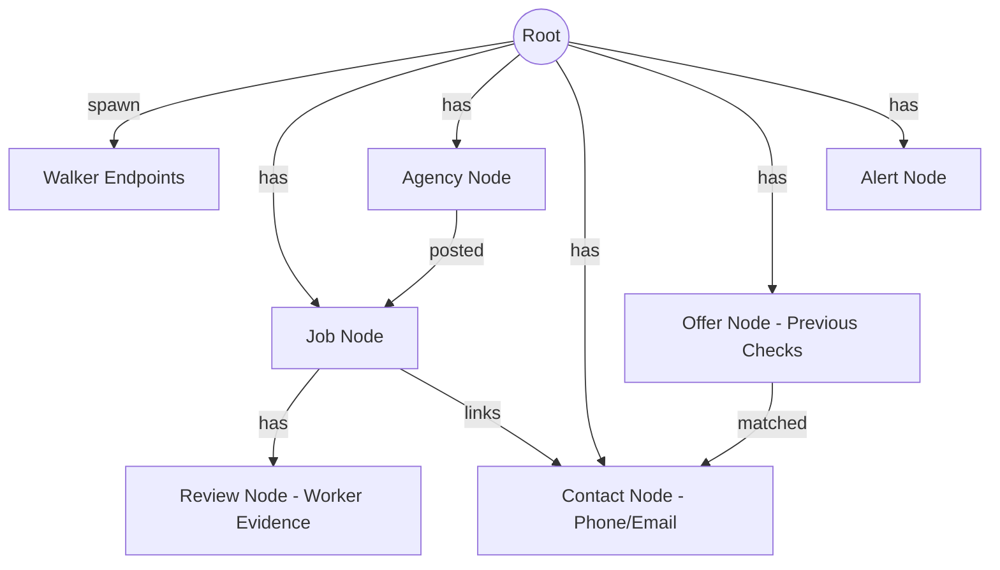

# SafeRata: Comprehensive System Audit & Architectural Review

**Document Version:** 1.0.0  
**Date:** 2026-10-17 14:32 UTC+5:30  
**Auditor:** Principal Software & Systems Architect  
**Project:** SafeRata (AI Hackathon 2026 - Jaseci / Jac)  
**Repository:** https://github.com/chirana07/saferata (`main`, commit `1116d58`)

---

## 1. Executive Summary & Problem Context

Over 300,000 Sri Lankans migrate abroad each year for employment (primarily to the Middle East, Southeast Asia, and East Asia). A rampant ecosystem of unlicensed sub-agents, human trafficking syndicates (notably Southeast Asian cyber scam compounds in Thailand/Myanmar/Cambodia), and license-impersonation fraudsters exploit these workers with fake visas, upfront fees, and debt bondage.

**SafeRata** is an autonomous multi-agent trust and forensic verification platform designed to protect migrant workers before they sign contracts or transfer funds.
It combines:
1. **Live Government Verification:** Direct querying against the official Sri Lanka Bureau of Foreign Employment (SLBFE) licensed-agency register (`applications.slbfe.lk`).
2. **Multi-Agent Courtroom & Adversarial Analysis:** A specialized team of AI agents (Extractor, Supervisor, Lead Investigator, Duplicate Detector, Legal Experts, Critic, Prosecutor, Defender, Judge, and Advisor) that analyze job adverts and contracts.
3. **Network Guardian Graph Intelligence:** A persistent shared Jaseci graph database tracking scam contacts, reused advert wording, and agency impersonations across community checks.
4. **Verified Civic Job Board:** Pre-screened genuine employment listings with automated wage-theft checks, salary currency conversions to LKR, take-home estimates, and evidence-backed worker reports.

---

## 2. Architecture & Technology Stack

### A. Core Stack
- **Language & Runtime:** `jac 0.34.24` (`~/.local/bin/jac034`).
- **Database & Graph Engine:** Jaseci Graph Architecture (backed by embedded PostgreSQL inside the Jac 0.34 runtime).
- **Frontend Layer:**
  - **Primary (Native):** Jac JSX Client (`main.jac`, `frontend.jac`, `components/*.jac`) served directly by `jac034 start --port 8000` via Vite and Tailwind CSS v4 (`assets/main.css`).
  - **Companion (Lovable / React):** `web-ui/` (React 18 + Vite + TanStack Router + Tailwind + shadcn-ui) with typed API client (`web-ui/src/lib/api.ts`).
- **LLM Agent Orchestration:** Jac `by llm` native syntax with `ModelPool` fallback (Ollama Cloud gemma4 $\rightarrow$ Gemini $\rightarrow$ Local Ollama).
- **Rule Engine & Deterministic Guardrails:** `rules.jac` enforces strict scoring caps (+20 maximum for subjective agent judgement) and literal quote-matching; the LLM is prohibited from determining legal license status.

### B. Application Entry Points
- `main.jac`: Root entry point exposing `walker:pub` endpoints and rendering the root JSX `<ClientApp/>`.
- `frontend.jac`: Client application shell with navigation, persistent live SLBFE register indicator, and route tab management.
- `scripts/api_e2e.py`: Automated 11-step end-to-end HTTP regression suite against `http://localhost:8000`.
- `evals.jac`: 8-case benchmark evaluation suite testing live agent verdicts against ground-truth labels.
- `seed.jac`: Idempotent graph seed loader initializing verified listings, checks, and agency nodes.

---

## 3. Database Architecture & Graph Entity Models

The application relies on Jaseci's graph data model where nodes and directional edges form the persistent business topology:

### Entity Specifications
1. **`Job` Node (`jobboard.jac:13-41`)**:
   - Stores employment metadata: `title`, `country`, `salary`, `description`, `licence_no`, `agency_name`, `contact_phone`, `posted_at`, `band`, `score`, `base_score`, `summary`, `warnings`, `occupation`, `experience_years`, `contract_type`, `contract_months`, `accommodation`, `deductions`, `monthly_deductions`, `worker_fee_lkr`, `appeals`, `corrections`, `findings_raw`.
2. **`Review` Node (`jobboard.jac:43-54`)**:
   - Stores moderated feedback: `author`, `kind` (fraud / positive / other), `text`, `evidence`, `credibility` (0-100), `status` (credible / unverified), `reason`, `impersonation` (boolean), `agency_response`, `created_at`.
3. **`Agency` Node (`graph.jac:3-10`)**:
   - Stores official government registry cache: `name`, `licence_no`, `valid_upto`, `checked_at`.
4. **`Contact` Node (`graph.jac:12-16`)**:
   - Graph hub for scam phone numbers and emails: `value`, `kind`, `first_seen`.
5. **`Offer` Node (`graph.jac:18-26`)**:
   - Historical check archive enabling de-duplication and scam repost detection: `text_hash`, `country`, `job_title`, `verdict`, `score`, `created_at`.
6. **`Alert` Node (`graph.jac:28-33`)**:
   - Community proactive warnings: `message`, `contact_value`, `created_at`.

---

## 4. Security, Identity & Authentication Architecture

### A. Agency Gatekeeping
- **Mechanism:** Any job submission (`PostJob`) performs a live HTTPS call to `applications.slbfe.lk/feb/la/la_details.asp`. If the license is not found or is expired, publication is rejected immediately with an explicit error.
- **Limitation:** There is currently no SMS OTP verification for agency personnel. Anyone possessing valid license number `3500` can post a listing or publish a response under that agency.

### B. Worker Privacy (Client-Side Persistence)
- Migrant workers in distress or investigating sensitive job offers are protected: SafeRata requires **no user accounts, passwords, or PII storage** on the backend.
- Candidate profiles (occupation, skills, experience, salary requirements) are stored exclusively in the browser's `localStorage` (`saferata.p.*`) and forwarded transiently to the `MatchJobs` calculation walker.

### C. Adversarial LLM Defense (The Critic & Quote-Matcher)
- LLMs are prone to hallucinating red flags. SafeRata prevents this with a deterministic `Evidence Critic` (`rules.jac`):
  - Every agent finding must quote the exact text from the advert word-for-word.
  - If the quoted excerpt cannot be located literally in the source text, the finding is discarded and 0 risk points are assigned.
  - Subjective agent risk scoring is strictly capped at +20 points.

---

## 5. System Defect, Risk & Completeness Classification

| Area | Status | Finding & Risk Assessment | Remediation |
| :--- | :--- | :--- | :--- |
| **SLBFE Registry Scraper** | **Implemented & Verified** | Live scraping of `applications.slbfe.lk` works reliably. However, the site can experience governmental maintenance downtime. | Robust fallback to cached `Agency` nodes in graph with `UNREACHABLE` status indicator. |
| **Agent Scoring & Courtroom** | **Implemented & Verified** | 16-step agent team with Prosecutor, Defender, and Judge delivers calibrated 0-100 risk bands. | 8/8 evaluation set passing; unit tests passing. |
| **Hackathon Jac Ratio** | **Implemented & Verified** | Codebase stands at **93.5% Jac** (3,644 Jac lines vs 37 Python lines). | `scripts/jac-ratio.sh` safely excludes vendored `web-ui/` shadcn components. |
| **Save & Compare Jobs** | **Implemented & Verified** | Integrated natively in Jac (`components/Discover.jac`) with side-by-side comparison modal and bookmarking. | Eliminates previous `<NotBuilt>` placeholder. |
| **Document Upload / OCR** | **Partially Implemented** | Agency portal captures filenames in memory (`files: list[str]`); no Cloud Storage or OCR backend exists. | Clearly flagged in UI: *"Only file names are kept: document upload and analysis are not built yet."* |
| **Agency Authentication** | **Partially Implemented** | Agency actions are authenticated solely by valid SLBFE license number without OTP/password. | Documented as known prototype limitation; future scope requires SMS gateway. |
| **Currency Conversions** | **Partially Implemented** | LKR conversions use fixed approximate exchange rates (e.g. SAR 1 = LKR 80, QAR 1 = LKR 82). | Accurately noted in documentation; live CBSL forex API can be added in future. |

---

## 6. Verification Test Summary

1. **Unit Test Suite:** `19/19 passed` (`jac034 test rules.jac agents.jac`).
2. **Component & Syntax Checks:** `9/9 passed` (`jac034 check main.jac frontend.jac components/*.jac`).
3. **End-to-End Walkers:** `11/11 passed` (`python3 scripts/api_e2e.py`).
4. **Live Port Binding:** Serving full-stack app on `http://localhost:8000/`.
